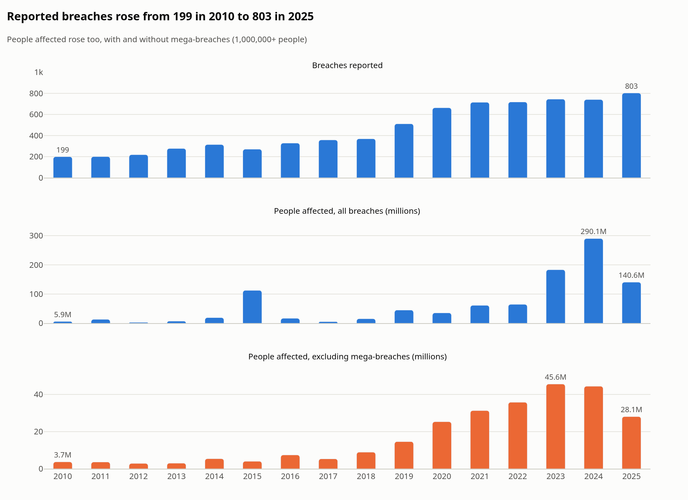
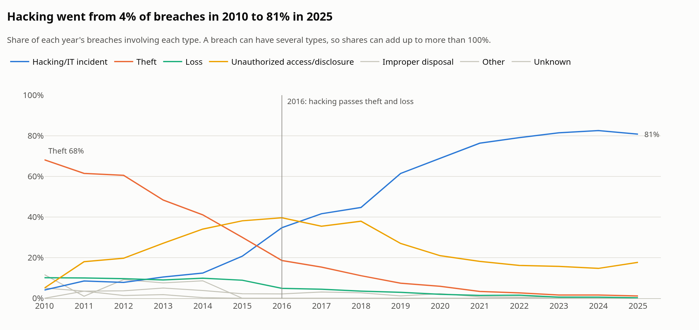
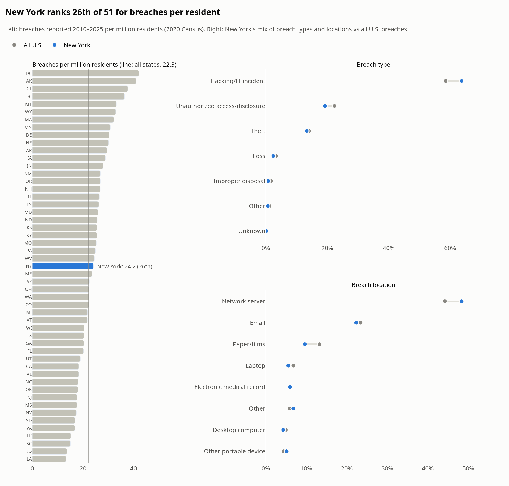

# HHS Healthcare Breach Analysis

**[Live dashboard](https://notkornflakes.github.io/hhs-breach-analysis/)**: the findings as interactive charts, readable on a phone.

**[Clinic memo](reports/clinic_memo.md)**: the findings applied to the security budget of a fictional 40-person clinic in Central New York.

An exploratory analysis of healthcare data breaches affecting 500 or more people, as reported to the U.S. Department of Health and Human Services (HHS) Office for Civil Rights.

## Data Source

- **Breaches:** U.S. Department of Health and Human Services, Office for Civil Rights, [Breach Portal](https://ocrportal.hhs.gov/ocr/breach/breach_report.jsf). CSV exports of the cases currently under investigation and the archive, downloaded October 10, 2026 (`data/raw/under_investigation.csv`, `data/raw/archive.csv`).
- **State population:** U.S. Census Bureau, 2020 Census resident population (as of April 1, 2020) for the 50 states and the District of Columbia (`data/raw/state_population.csv`). Taken from the 2020 rows of the Census Bureau's [historical apportionment data](https://www2.census.gov/programs-surveys/decennial/2020/data/apportionment/apportionment.csv) and checked against [Table 2: Resident Population for the 50 States, the District of Columbia, and Puerto Rico](https://www2.census.gov/programs-surveys/decennial/2020/data/apportionment/apportionment-2020-table02.xlsx).

## Key Findings

- **Breaches have quadrupled.** Reported healthcare breaches rose from 199 in 2010 to 803 in 2025. People affected per year rose from 5.9 million to 140.6 million, peaking at 290.1 million in 2024; excluding mega-breaches (1 million+ people), the rise was from 3.7 million to 28.1 million.
- **Hacking replaced theft and loss.** Theft was involved in 68% of breaches in 2010. Hacking overtook theft and loss in 2016 and was involved in 81% of breaches by 2025.
- **Vendors are involved more often.** Breaches involving a business associate rose from 23% of all breaches in 2010–2014 to 35% in 2021–2025. Their share of people affected rose from 46% to 67%, but a few huge vendor breaches drove that: excluding mega-breaches, it fell from 38% to 33%.
- **Network servers lead on both count and size.** Of all 8,013 breaches (2009–2026), 3,691 (46%) involved a network server, with a median of 9,967 people affected, about three times the median for email breaches.
- **New York is in the middle.** New York ranks 26th of the 50 states and DC, with 24.2 breaches per million residents in 2010–2025, close to the national rate of 22.3. DC (42.1), Alaska (40.9) and Connecticut (37.7) have the highest rates.







All five charts, with the reasoning behind each, are in the [analysis notebook](notebooks/02_analysis.ipynb). The [cleaning notebook](notebooks/01_cleaning.ipynb) documents how the raw exports were combined and checked.

## Dashboard

The [live dashboard](https://notkornflakes.github.io/hhs-breach-analysis/) is a single page, `docs/index.html`, published with GitHub Pages. It loads Plotly from a CDN and embeds only small aggregated results (`reports/dashboard_data.json`, saved by the analysis notebook), not the full dataset.

To rebuild it after rerunning the notebooks:

```bash
.venv/bin/python dashboard/build_dashboard.py
```

Chart images are exported with kaleido, which needs Chrome. Run `.venv/bin/plotly_get_chrome -y` once before running the analysis notebook.

## Limitations

- **Only breaches of 500 or more people.** HHS publishes breaches affecting at least 500 people, so smaller breaches aren't in the data.
- **Self-reported data.** Organizations report their own breaches. Counts and categories are as submitted, and the number of people affected is often an estimate.
- **Counted by the reporting organization's state,** not where the affected people live. Per-resident rates use 2020 Census populations for every year.
- **Mega-breaches dominate totals.** The 152 breaches of 1,000,000+ people drive totals and averages, so people-affected results are shown with and without them, and typical breaches are described by medians.
- **Partial years.** The data runs from October 21, 2009 to September 21, 2026, so trends use 2010–2025.
- **Overlapping categories.** A breach can have several types and locations, so shares can add up to more than 100%.
- **Duplicates removed.** The export lists McEwen & Associates (August 21, 2025, 500 people) three times with identical details. Two copies were removed as exact duplicates, but the export has no report ID, so they could in fact be three separate filings.
- **Possible repeat filings kept.** Four pairs of records share an organization, submission date and number of people affected but differ in other details. They were kept, but may be the same breach filed twice:
  - Area Agency of Aging 1-B (April 13, 2017, 1,741 people): different descriptions
  - Original Medicine Acupuncture & Wellness, LLC (November 21, 2012, 540 people): different descriptions
  - Sturgis Hospital (September 18, 2025, 77,771 people): different covered entity types
  - West Sound Treatment Center (October 11, 2018, 2,300 people): different breach types, locations and descriptions
- **Other data quirks.** Two column headers in the export are broken (`javax.faces.component.UIPanel@…`) and are renamed by position. 14 organization names appear with different capitalization. A few fields are blank: state (23 records), covered entity type (5), people affected (1) and breach type (1).
